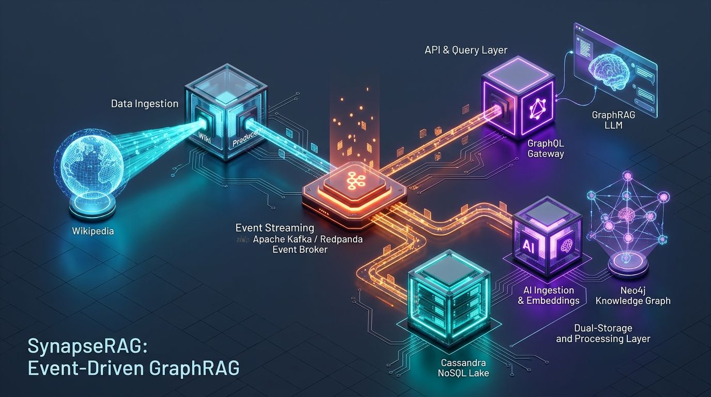

# SynapseRAG: Event-Driven GraphRAG Microservices Platform

[](#-kiến-trúc-luồng-dữ-liệu-data-pipeline-architecture)
[](https://redpanda.com/)
[](https://cassandra.apache.org/)
[](https://neo4j.com/)
[](https://graphql.org/)

<p align="center">
  
</p>

**SynapseRAG** là hệ thống kiến trúc Microservices phân tán kết hợp **Event-Driven Streaming (Kafka / Redpanda)**, **Kho lưu trữ NoSQL thô (Apache Cassandra)**, **Đồ thị tri thức & Vector (Neo4j GraphRAG)** và **Cổng truy vấn linh hoạt (GraphQL API)**.

---

## 🏗️ Kiến trúc luồng dữ liệu (Data Pipeline Architecture)

Hệ thống áp dụng mô hình **Fan-out Architecture** qua Kafka topic `wiki-raw-articles`. Hai Worker chạy độc lập bằng 2 Consumer Groups riêng biệt, giải quyết triệt để bài toán Dual-write / Distributed Transactions:

```
                  ┌───────────────────────────────┐
                  │ 1. wiki-producer              │  Cào / Fetch bài viết từ Wikipedia
                  └───────────────┬───────────────┘
                                  │  Topic: `wiki-raw-articles` (Key = page_id)
                                  ▼
                   ┌─────────────────────────────┐
                   │    Apache Kafka / Redpanda  │
                   └──────────────┬──────────────┘
                                  │
         ┌────────────────────────┴────────────────────────┐
         │ (Consumer Group: `cassandra-sink-group`)        │ (Consumer Group: `ai-ingestion-group`)
         ▼                                                 ▼
┌───────────────────────────────┐                 ┌───────────────────────────────┐
│ 2. cassandra-sink-worker      │                 │ 3. ai-ingestion-worker        │
│ Lưu trữ bất biến bài viết thô │                 │ Clean text, Chunking,         │
│ phục vụ Data Lake & Replay    │                 │ Sinh Vector Embedding         │
└───────────────┬───────────────┘                 └───────────────┬───────────────┘
                ▼                                                 ▼
┌───────────────────────────────┐                 ┌───────────────────────────────┐
│ Apache Cassandra              │                 │ Neo4j (Graph + Vector Index)  │
│ Keyspace: `wiki_knowledge`    │                 │ Lưu Node (:Article), (:Chunk) │
│ Table: `raw_articles`         │                 │ Mối quan hệ [:MENTIONS],...   │
└───────────────────────────────┘                 └───────────────┬───────────────┘
                                                                  │
                                                                  ▼
                                                  ┌───────────────────────────────┐
                                                  │ 4. rag-graphql-gateway        │
                                                  │ Cung cấp GraphQL Endpoint     │
                                                  │ Hybrid Search & RAG Answer    │
                                                  └───────────────┬───────────────┘
                                                                  │
                                                                  ▼
                                                      [ Client / UI Dashboard ]
```

---

## 📁 Cấu trúc thư mục Monorepo

```text
C:\Projects\Microsevice\
├── .env.example                     # Biến môi trường mẫu chung
├── .env                             # Biến môi trường hiện tại
├── .gitignore
├── docker-compose.yml               # Quản lý hạ tầng container (Redpanda Kafka, UI, DBs)
├── README.md                        # Tài liệu hướng dẫn kiến trúc & vận hành
│
├── shared/                          # Module dùng chung (Data Contracts & Config tập trung)
│   ├── __init__.py
│   ├── config.py                    # Nạp biến môi trường tập trung
│   └── schemas/
│       ├── __init__.py
│       └── wiki_message.py          # Pydantic schema contract (có schema_version, page_id,...)
│
├── services/                        # Các Microservices độc lập
│   │
│   ├── wiki-producer/               # Service 1: Thu thập Wikipedia -> Push vào Kafka [✅ ĐÃ HOÀN THÀNH]
│   │   ├── config.py
│   │   ├── requirements.txt
│   │   └── main.py                  # Entrypoint nạp bài viết và đẩy Kafka
│   │
│   ├── cassandra-sink-worker/       # Service 2: Consume Kafka -> Ghi vào Cassandra Raw Data Lake
│   │   ├── config.py
│   │   ├── requirements.txt
│   │   └── main.py
│   │
│   ├── ai-ingestion-worker/         # Service 3: Consume Kafka -> Chunking -> Embedding -> Neo4j
│   │   ├── config.py
│   │   ├── requirements.txt
│   │   └── main.py
│   │
│   └── rag-graphql-gateway/         # Service 4: GraphQL API (FastAPI + Strawberry) + LLM RAG Pipeline
│       ├── config.py
│       ├── requirements.txt
│       └── main.py
│
└── infrastructure/                  # Scripts khởi tạo database và hạ tầng
    ├── neo4j/
    │   ├── init-schema.cypher       # Script tạo Vector Index & Unique Constraints
    │   └── apply_schema.py          # Python runner khởi tạo schema Neo4j
    └── cassandra/
        └── init-keyspace.cql        # CQL script tạo Keyspace & Table với Partition Key chuẩn
```

---

## 🛠️ Trạng thái triển khai các thành phần

| Thành phần | Trạng thái | Ghi chú kỹ thuật |
| :--- | :---: | :--- |
| **Monorepo & Shared Contract** | ✅ Xong | Đã chuẩn hóa `WikiArticleMessage` với versioning `1.0`. |
| **Kafka / Redpanda Broker** | ✅ Đang chạy | Chạy qua WSL2 Docker, port `9092` kết nối ổn định từ Windows. |
| **Service 1: `wiki-producer`** | ✅ Xong | Đã crawl bài viết tiếng Việt (*"Trí tuệ nhân tạo"*, *"Học máy"*) & publish thành công. |
| **Service 2: `cassandra-sink-worker`** | ⏳ Kế tiếp | Đọc song song từ Kafka topic `wiki-raw-articles`, ghi vào Cassandra. |
| **Service 3: `ai-ingestion-worker`** | ⏳ Kế tiếp | Chia đoạn (text chunking), tạo embeddings và lưu vào Graph/Vector DB. |
| **Service 4: `rag-graphql-gateway`** | ⏳ Kế tiếp | Endpoint `/graphql` cho phép đặt câu hỏi và truy vấn đồ thị tri thức. |

---

## 🚀 Hướng dẫn vận hành nhanh

### 1. Khởi động hạ tầng Broker
Khởi động cụm Redpanda và Web Console qua WSL:
```powershell
wsl -d Ubuntu bash -c "cd /mnt/c/Projects/Microsevice && docker compose up -d"
```
* **Redpanda Console UI:** Mở trình duyệt tại [http://localhost:8080](http://localhost:8080) để xem topics và message trực quan.

### 2. Chạy Service 1 (`wiki-producer`)
Chạy producer để nạp thêm bài viết vào hệ thống:
```powershell
python services/wiki-producer/main.py
```
